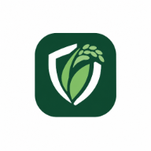

# CropShield (பயிர் பாதுகாப்பு)

<div align="center">
  
  <p><strong>Rice Crop Health & Agricultural Pathology Intelligence Platform</strong></p>
  <p>Engineered specifically for paddy farmers in Tamil Nadu, India.</p>
</div>

---

## 🌾 About CropShield

**CropShield** is an AI-powered agricultural intelligence and pathology diagnostics platform designed for paddy farmers across the Cauvery Delta and Tamil Nadu agro-climatic zones. It enables early detection of crop stresses, rice blast, bacterial leaf blight, sheath rot, and provides region-tailored agronomic recommendations in both **Tamil (தமிழ்)** and **English**.

### Key Features
- **AI Crop Pathology Scanner**: Instant visual diagnosis and severity scoring for paddy diseases.
- **Micro-Climate Risk Intelligence**: Delta region weather monitoring and disease vulnerability indexing.
- **Bilingual Accessibility**: Full support for Tamil and English with localized agricultural terminology.
- **Farmer Dashboard & Plot Management**: Track crop varieties (CR 1009, BPT 5204, ADT 45, etc.), planting dates, and treatment history.
- **Firebase Authentication & Cloud Storage**: Secure farmer profiles and field record persistence.

---

## 🚀 Getting Started

### Prerequisites
- Node.js (v18 or later)
- npm or bun

### Installation
```bash
# Clone the repository
git clone https://github.com/naren1111naren-cloud/CROPSHIELD.git
cd CROPSHIELD

# Install dependencies
npm install
```

### Environment Configuration
Copy `.env.example` to `.env` and fill in your Firebase and Gemini credentials:
```bash
cp .env.example .env
```

### Run Locally
```bash
# Start development server
npm run dev
```

### Build for Production
```bash
npm run build
```

---

## 🛡️ License
MIT License
